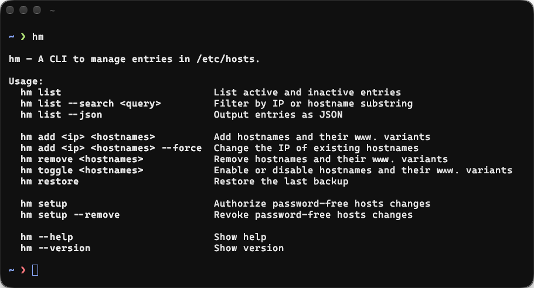

# hm

A CLI to manage entries in `/etc/hosts`.

## Why?

Manage `/etc/hosts` entries without an editor or typing `sudo` for each change.

## Preview



## Installation

### Requirements

- `macOS 11` or later on a Mac with Apple silicon.

### Quick Start

Run this command in your terminal to download and install the latest release.

```bash
curl -fsSL https://raw.githubusercontent.com/wereallcode/hm/master/scripts/install.sh | bash
```

Open a new terminal and run `hm list`; use `hm --help` or `hm --version` for details.

_If `hm` is not found, follow the installer's instructions to add `$HOME/.local/bin` to your shell's `PATH`._

Run `hm setup` once to authorize password-free changes to `/etc/hosts`.

```bash
hm setup
```

Setup requests administrator approval for this user.

#### Update

Run the installation command again to update to the latest release.

#### Uninstall

To uninstall the release installation, run:

```bash
curl -fsSL https://raw.githubusercontent.com/wereallcode/hm/master/scripts/install.sh | bash -s -- --uninstall
```

This removes hm's installed files, command link and authorization; hosts entries, backups and shell configuration are preserved.

## Guides

- [Manual Installation](docs/guides/Manual-Installation.md)
